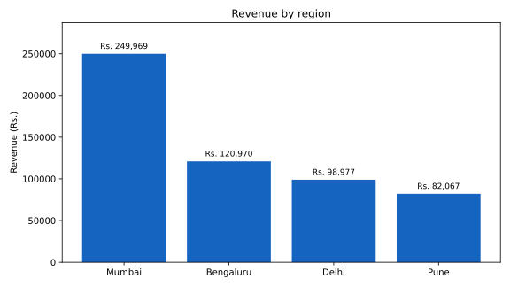

# Day 1 — Sales Analysis: Revenue by Region & Product

Day 1, and I started simple: a small electronics-store sales dataset (20
orders, 4 cities). I answered the same 6 questions twice — once in Python
(pandas) and once in SQL (SQLite) — just to prove to myself that both
tools give the same answers.

## Business questions

| # | Question | Python | SQL |
|---|----------|--------|-----|
| Q1 | Total revenue | `df['amount'].sum()` | `SUM(quantity * unit_price)` |
| Q2 | Revenue by region | `groupby('region')` | `GROUP BY region` |
| Q3 | Revenue by category | `groupby('category')` | `GROUP BY category` |
| Q4 | Top 3 products by revenue | `groupby + sort + head(3)` | `ORDER BY revenue DESC LIMIT 3` |
| Q5 | Average order value | `df['amount'].mean()` | `AVG(quantity * unit_price)` |
| Q6 | Total units sold | `df['quantity'].sum()` | `SUM(quantity)` |

## Results (verified — Python and SQL agree exactly)

- **Total revenue:** ₹5,51,983
- **Revenue by region:** Mumbai ₹2,49,969 · Bengaluru ₹1,20,970 · Delhi ₹98,977 · Pune ₹82,067
- **Revenue by category:** Computers ₹3,54,991 · Accessories ₹81,527 · Storage ₹64,987 · Audio ₹50,478
- **Top 3 products:** Laptop ₹2,20,000 · Monitor ₹77,994 · SSD 512GB ₹64,987
- **Average order value:** ₹27,599.15
- **Total units sold:** 121

Mumbai alone is 45% of the revenue, and one product — the Laptop — is
worth ₹2,20,000 by itself. That was the first thing that jumped out at
me when the numbers came back.

*Revenue by region — Mumbai alone is ₹2,49,969, more than Delhi and Pune put together (₹1,81,044).*

## Files

- `data/sales.csv` — the dataset (20 rows)
- `python_analysis.py` — pandas analysis (`python3 python_analysis.py`)
- `queries.sql` — the SQL queries
- `sql_analysis.py` — loads the CSV into in-memory SQLite and runs the queries (`python3 sql_analysis.py`)

## What I practised

- pandas: `read_csv`, calculated columns, `groupby` + `sum` + `sort_values`, `head`
- SQL: `SUM`, `AVG`, `GROUP BY`, `ORDER BY ... DESC`, `LIMIT`

## What I found

- Mumbai brings ₹2,49,969 of the ₹5,51,983 total — about 45%. Nearly half the shop's money depends on one city, so if Mumbai has a slow month, the whole total drops with it.
- Computers are the real business: ₹3,54,991, about 64% of all revenue, and laptops alone are ₹2,20,000. The other three categories together are smaller than computers by themselves.
- Pune is the smallest region at ₹82,067 (about 15%) — less than a third of Mumbai. That gap is also the opportunity: Pune is where growth can come from without depending even more on Mumbai.

What stuck with me: `groupby` in pandas and `GROUP BY` in SQL are the
same idea in two languages. Once you can turn a business question into a
grouping, the tool is just syntax.
