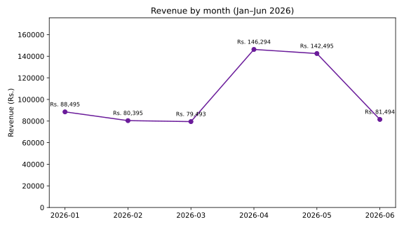

# Day 4 — Monthly Sales Trend: Date Functions

Day 4 was all about dates. 30 orders from a Pune electronics store
(Jan–Jun 2026, 5 orders every month), and the same 6 questions in pandas
and in SQL (SQLite date functions) — and the answers matched exactly.

## Business questions

| # | Question | Python | SQL |
|---|----------|--------|-----|
| Q1 | Total revenue and order count by month | `dt.strftime('%Y-%m') + groupby` | `strftime('%Y-%m', order_date) + GROUP BY` |
| Q2 | Month-over-month revenue growth % | `shift(1)` for previous month | `LAG() OVER (ORDER BY month)` |
| Q3 | Best month by revenue | `idxmax()` | `ORDER BY total_revenue DESC LIMIT 1` |
| Q4 | Average order value by month | `groupby + mean()` | `AVG(quantity * unit_price)` |
| Q5 | Weekend vs weekday orders | `dt.dayofweek >= 5` | `strftime('%w', order_date) IN ('0','6')` |
| Q6 | Quarterly totals — Q1 vs Q2 2026 | `dt.quarter` | `CASE WHEN CAST(strftime('%m', ...) AS INTEGER) BETWEEN 1 AND 3` |

## Results (verified — Python and SQL agree exactly)

- **Total revenue (Jan–Jun 2026):** ₹6,18,666 from 30 orders
- **Revenue by month:** Jan ₹88,495 · Feb ₹80,395 · Mar ₹79,493 · Apr ₹1,46,294 · May ₹1,42,495 · Jun ₹81,494 — 5 orders every month
- **Month-over-month growth:** Feb −9.2% · Mar −1.1% · Apr **+84.0%** (biggest jump — two laptops sold) · May −2.6% · Jun −42.8%
- **Best month:** April 2026 — ₹1,46,294 from 5 orders
- **Average order value by month:** Jan ₹17,699.00 · Feb ₹16,079.00 · Mar ₹15,898.60 · Apr ₹29,258.80 · May ₹28,499.00 · Jun ₹16,298.80 — April and May are nearly double the other months
- **Weekend vs weekday:** 7 weekend orders brought ₹1,88,092 (30% of revenue) vs 23 weekday orders at ₹4,30,574
- **Quarterly totals:** Q1 ₹2,48,383 (15 orders) · Q2 ₹3,70,283 (15 orders) — Q2 beat Q1 by 49% on the same order count

April nearly doubled the other months on the same 5 orders — two laptops
did that. And Q2 beat Q1 by 49% with the exact same number of orders,
which tells you it was about *what* sold, not how much.

*Revenue by month — flat around ₹80,000 for three months, then April jumps to ₹1,46,294 and June falls right back to ₹81,494.*

## Files

- `data/orders.csv` — the dataset (30 rows: 5 orders × 6 months, Jan–Jun 2026)
- `python_analysis.py` — pandas analysis (`python3 python_analysis.py`)
- `queries.sql` — the SQL queries
- `sql_analysis.py` — loads the CSV into in-memory SQLite and runs the queries (`python3 sql_analysis.py`)

## What I practised

- pandas: `parse_dates`, `dt.strftime`, `dt.quarter`, `dt.dayofweek`, `pct_change`-style growth with `shift`
- SQL: `strftime('%Y-%m' / '%w' / '%m')` for month, weekday and quarter extraction, `LAG()` for month-over-month comparison

## What I found

- April's +84.0% jump (₹79,493 → ₹1,46,294) was not more customers — every month has exactly 5 orders. It was two laptops in one month. Big-ticket items, not steady growth, moved the line, so April should not be treated as the new normal — June fell back to ₹81,494.
- Weekend orders are fewer but bigger: only 7 of the 30 orders, yet they brought ₹1,88,092 — about 30% of all revenue. An average weekend order is ₹26,870 against ₹18,721 on a weekday, so weekends deserve the best stock and staffing.
- Q2 beat Q1 by 49% (₹3,70,283 vs ₹2,48,383) with the same 15 orders. All the "growth" came from bigger bills, not more bills — the store sells to the same number of people, they just spent more in April and May.

What stuck with me: dates are dimensions, not labels. Once you can pull
month, quarter and weekday out of a date, the same sales table starts
telling you *when* the business actually happens.
