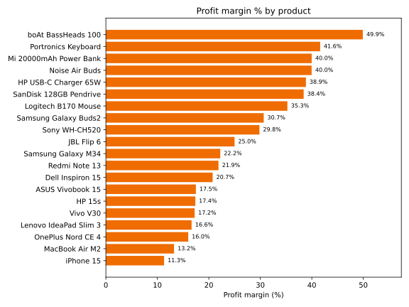

# Day 5 — Product Profitability: CASE WHEN & CTEs

Day 5 was about the gap between revenue and profit. 20 products from a
Pune electronics store, analysed in pandas and in SQL (SQLite `CASE
WHEN` + CTEs). Revenue is not profit — that's the whole point of this
one.

## Business questions

| # | Question | Python | SQL |
|---|----------|--------|-----|
| Q1 | Profit margin % per product, labelled High / Medium / Low | `np.select` on margin % | `CASE WHEN margin >= 40 THEN 'High' ...` |
| Q2 | Products and total profit per margin band | `groupby('margin_band')` | CTE `margins` + `GROUP BY` |
| Q3 | Products priced above their category's average selling price | `groupby().transform('mean')` | CTE `category_avg` + `JOIN` |
| Q4 | Stock status (In stock / Low stock / Out of stock) and units sold | `apply` + `groupby` | CTE `stocked` with `CASE WHEN` |
| Q5 | Category summary: revenue, profit, average margin | `groupby().agg()` | CTE `category_summary` |
| Q6 | Top 3 products by total profit | `nlargest(3, 'total_profit')` | `ORDER BY total_profit DESC LIMIT 3` |

## Results (verified — Python and SQL agree exactly)

- **Total revenue:** ₹75,15,501 from 706 units sold · **total profit: ₹14,54,301**
- **Margin bands:** High (≥40%) — 2 products, ₹49,840 profit · Medium (20–40%) — 11 products, ₹6,82,868 · Low (<20%) — 7 products, ₹7,21,593
- **Best margin:** boAt BassHeads 100 at 49.9% (₹499, cost ₹250) · **worst:** iPhone 15 at 11.3%
- **Above category average price:** 6 of 20 products — iPhone 15 & MacBook Air M2 (the premium flagships), JBL Flip 6 & Galaxy Buds2, Mi Power Bank & HP Charger
- **Stock status:** 15 products in stock (610 units sold) · 3 low stock (42 units) · 2 out of stock — ASUS Vivobook 15 and Portronics Keyboard, which still sold 54 units between them, so restock them first
- **Category summary:** Mobile leads revenue (₹33,91,676) and profit (₹5,88,676) but at the lowest average margin (17.73%) · Accessories has the best average margin (38.82%) on the smallest revenue (₹3,22,631) · Audio 35.07% · Laptop 17.10%
- **Top 3 by total profit:** Redmi Note 13 ₹1,46,958 · Samsung Galaxy M34 ₹1,39,965 · Dell Inspiron 15 ₹1,20,890 — volume beats margin: the top earners are mid-margin phones, not the 49.9% earbuds

The earbuds have the best margin in the shop (49.9%) and still aren't
anywhere near the top earners — the mid-margin phones sell in such volume
that they win on total profit anyway. That surprised me.

*Profit margin % by product — the cheapest item (boAt earbuds, ₹499) keeps the biggest share of its price, and the most expensive one (iPhone 15, ₹69,900) keeps the smallest.*

## Files

- `data/products.csv` — the dataset (20 rows: product, category, cost/selling price, units sold, stock)
- `python_analysis.py` — pandas analysis (`python3 python_analysis.py`)
- `queries.sql` — the SQL queries
- `sql_analysis.py` — loads the CSV into in-memory SQLite and runs the queries (`python3 sql_analysis.py`)

## What I practised

- pandas: `np.select` as the `CASE WHEN` equivalent, `groupby().transform()` for category averages, `nlargest`
- SQL: `CASE WHEN` for margin bands and stock status, CTEs (`WITH ... AS`) to compute once and reuse, `JOIN` against a CTE

## What I found

- Volume and profit are different things. The boAt BassHeads 100 has the best margin in the shop (49.9%) but sells for ₹499; the Redmi Note 13 keeps a smaller share of a ₹15,999 price and sold 42 units, ending as the top profit earner at ₹1,46,958. A big percentage of a small price is still small money.
- The iPhone 15 looks like the star — ₹69,900 a piece — but its margin is the worst in the shop at 11.3%. Mobile as a category has the highest revenue (₹33,91,676) and the lowest average margin (17.73%): it brings the crowd, not the profit per sale.
- Accessories are the quiet earners: the best average margin (38.82%) on the smallest revenue (₹3,22,631). Attaching one accessory to every phone or laptop sale is probably the cheapest profit this shop can add.

What stuck with me: `CASE WHEN` turns a continuous number into a
business decision (High / Medium / Low), and CTEs let you build that
logic step by step instead of one giant unreadable query.
