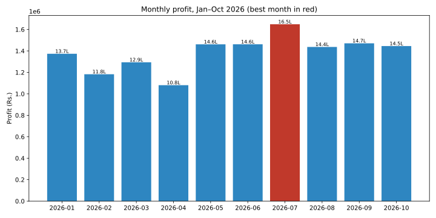

# Day 10 — CTEs in Detail: Monthly Profitability on ~2,000 Orders

Which months and categories actually make the store money — and which
month was our best ever? Day 5 did this on 20 products; today I redid
the same profitability analysis on 2,000 orders, using a CTE chain:
first a `cleaned` CTE, then a `monthly` summary CTE on top of it, then
a `ranked` CTE that ranks the months, plus `LAG()` for month-on-month
growth. Each CTE feeds the next one, so the query reads like steps
instead of one giant block.

## Dataset

`data/orders.csv` — 2,008 rows, 8 columns (`order_id`, `order_date`,
`product`, `category`, `city`, `selling_price`, `cost_price`,
`quantity`). Orders from Jan–Oct 2026 for a Pune electronics store,
5 categories, 8 Maharashtra cities. Synthetic practice data
(generated with Python, seed 42) — no real store's data, so it is
labelled honestly as synthetic.

The file is slightly dirty on purpose, and both scripts clean it the
same way: 10 rows with a missing `cost_price`, 5 rows with quantity 0
or -1, 8 duplicate `order_id` rows, and 4 rows with messy category
text (`"mobile"`, `"Laptop "` with a trailing space). After cleaning:
**1,985 clean orders**. One thing the cleaning does not fix: the 4
messy-category rows keep their product name, so "HP Keyboard" still
counts as a Laptop product in Q4 — the label was fixed, the row's
meaning was not. That is in "What I learned" below.

## Questions & results

| # | Question | Answer |
|---|----------|--------|
| Q1 | Monthly revenue, profit and margin | Best month July: ₹85,35,396 revenue, ₹16,48,564 profit, 19.31% margin, 225 orders. Worst month April: ₹59,62,705 revenue, ₹10,80,482 profit, 18.12% margin. September has the highest margin (20.30%) — the only month above 20% |
| Q2 | Months ranked by profit | 1. July ₹16,48,564; 2. September ₹14,70,883; 3. June ₹14,61,832; 4. May ₹14,61,488; 5. October ₹14,45,380; 6. August ₹14,37,144; 7. January ₹13,73,457; 8. March ₹12,94,033; 9. February ₹11,82,604; 10. April ₹10,80,482 |
| Q3 | Best category in each month | Laptop wins all 10 months — July ₹7,07,923, January ₹6,86,410, June ₹6,82,852, October ₹6,38,720, August ₹6,00,582, September ₹5,92,452, May ₹5,79,395, March ₹5,28,491, February ₹5,18,903, April ₹4,66,043 |
| Q4 | Category summary with margin band (same bands as Day 5) | Laptop: 373 orders, ₹3,11,32,327 revenue, ₹60,01,771 profit, 19.28% — Low. Mobile: 423 orders, ₹2,10,33,578 revenue, ₹40,21,056 profit, 19.12% — Low. TV & Audio: 422 orders, ₹1,30,67,058 revenue, ₹24,75,562 profit, 18.95% — Low. Home Appliances: 380 orders, ₹61,67,357 revenue, ₹11,81,198 profit, 19.15% — Low. Accessories: 387 orders, ₹9,22,321 revenue, ₹1,76,280 profit, 19.11% — Low |
| Q5 | Month-on-month profit growth | Biggest jump May: +35.26% after April's -16.50% dip. July +12.77%, March +9.42%, September +2.35%, June +0.02% (flat vs May). Falls: February -13.90%, August -12.82%, October -1.73% |
| Q6 | Top 3 months and the category that drove each | July ₹16,48,564 — Laptop; September ₹14,70,883 — Laptop; June ₹14,61,832 — Laptop |

Totals: 1,985 clean orders, total revenue **₹7,23,22,641**, total
profit **₹1,38,55,867**, overall margin **19.16%**.

## What I found

- July is the best month by a clear gap — ₹16,48,564 profit, about 12% ahead of September (₹14,70,883) — and Laptop drove it (₹7,07,923 of July's profit). The store should stock laptops deep before the July peak instead of spreading stock evenly across the year.
- Laptop is the best category in all 10 months and brings 43% of all profit (₹60,01,771 of ₹1,38,55,867) from only 19% of the orders. The store's profit depends on one category: April, the worst month overall, is also Laptop's worst month (₹4,66,043). If laptop demand dips, the whole month dips.
- All five categories land in the "Low" margin band (18.95%–19.28%) — on Day 5's 20 products the bands separated nicely, but on 1,985 orders every category averages about 19%. So margin mix is not the lever here; volume is. Accessories proves it: 387 orders — the second-most of any category — for just ₹1,76,280 profit. Pushing high-ticket categories matters more than squeezing margin.

## Python vs SQL approach

| Step | Python (pandas) | SQL (SQLite) |
|------|-----------------|--------------|
| Cleaning | `dropna` on `cost_price`, filter `quantity > 0`, `drop_duplicates("order_id")`, category map after `strip().lower()` | `WHERE cost_price IS NOT NULL AND quantity > 0`, `rowid IN (SELECT MIN(rowid) ... GROUP BY order_id)`, `CASE LOWER(TRIM(category))` |
| Monthly summary | `groupby("month").agg(...)` | `monthly` CTE: `GROUP BY month` |
| Ranking months | `.rank(method="min", ascending=False)` | `ranked` CTE: `RANK() OVER (ORDER BY profit DESC)` |
| Best category per month | `groupby(["month","category"])` + rank within month | `RANK() OVER (PARTITION BY month ORDER BY profit DESC)` |
| Margin band | `np.select`-style lambda: High ≥ 30, Medium ≥ 20 | `CASE WHEN margin_pct >= 30 ...` |
| MoM growth | `.shift(1)` for the previous month | `LAG(profit) OVER (ORDER BY month)` |
| Rounding to 2 decimals | `Decimal` + `ROUND_HALF_UP` (see Day 9 note) | `ROUND(x, 2)` |
| Top 3 months + driver | `nsmallest(3, "profit_rank")` + merge | `JOIN` of `ranked` and best-category CTEs, `WHERE profit_rank <= 3` |

## Chart



Monthly profit, Jan–Oct 2026 (values in lakh ₹). July (red) is the
clear best month at ₹16.49 lakh; April is the worst at ₹10.80 lakh,
and the May bounce (+35.26%) only just gets profit back to the
January level.

## What I learned

- **A CTE chain reads like steps, not one giant query.** `cleaned`
  → `monthly` → `ranked` means I can check each step's output on
  its own, and a mistake shows up in the step where it happened
  instead of somewhere inside a 40-line query. The `LAG()` for
  month-on-month growth just sits on top of the same `monthly` CTE
  instead of needing the whole summary rewritten.
- **No rounding mismatch this time.** The Python script rounds
  percentages with `Decimal` + `ROUND_HALF_UP` (the Day 9 fix) and
  it matched SQLite's `ROUND()` on all 10 monthly margins and all 9
  month-on-month growth figures — both scripts print the same
  numbers, including September's 20.30% and May's +35.26%.
- **Fixing a label does not fix the row.** The 4 messy-category rows
  were tidied by lowercasing and stripping, but "HP Keyboard" still
  counts as a Laptop product in Q4's distinct-product count
  (Laptop shows 8 products instead of 6). Real cleaning would
  re-derive the category from the product name; here I kept the
  simple rule so both scripts agree, and wrote the quirk down
  instead of hiding it.

## How to run

```bash
python3 python_analysis.py   # pandas version (also saves chart.svg)
python3 sql_analysis.py      # loads the CSV into SQLite and runs queries.sql
```

Both print the same answers. The biggest lesson: **a CTE chain turns
one big question into small checkable steps** — clean once, summarise,
then rank on top of the summary.
