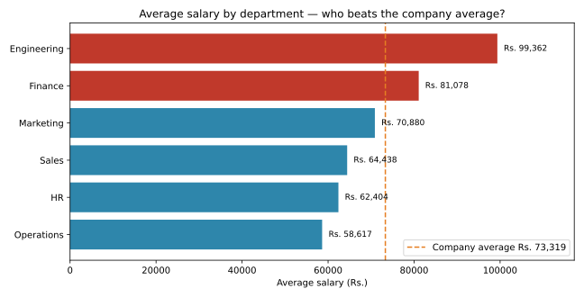

# Day 11 — Subqueries: Classic Interview Questions on ~500 Employees

Who earns more than the average employee — and who earns more than
the average *in their own department*? What is the second-largest
order, and who never placed an order at all? All six questions today
are answered with subqueries: a query inside another query. In pandas
that is just two steps — work out the inner number first, then filter
with it — which is exactly what a subquery does in SQL. The interview
classics are here on purpose: "employees above average salary" and
"second-largest order" come up in almost every data-analyst interview.

## Dataset

`data/employees.csv` — 524 rows, 6 columns (`employee_id`, `name`,
`department`, `city`, `salary`, `joining_date`). `data/orders.csv` —
624 rows, 5 columns (`order_id`, `employee_id`, `order_date`,
`order_amount`, `city`). Employees of a Pune IT-services company,
6 departments, 6 cities, joining dates 2019–2026. Synthetic practice
data (generated with Python, seed 42) — no real company's data, so it
is labelled honestly as synthetic.

The files are slightly dirty on purpose, and both scripts clean them
the same way: 6 rows with a missing salary, 3 rows with a negative
salary, 4 duplicate `employee_id` rows, and 5 rows with messy
department text (`"engineering"`, `"Sales "` with a trailing space,
`"  HR"`). Orders: 5 rows with a missing `order_amount`, 4 duplicate
`order_id` rows. After cleaning: **511 employees, 615 orders**.

## Questions & results

| # | Question | Answer |
|---|----------|--------|
| Q1 | Employees earning above the company average salary (scalar subquery) | Company average is ₹73,319. **223 of 511 employees (43.64%)** earn more than that; their average is ₹93,620. Top earner: Kavya Tiwari (Engineering, ₹1,39,529) |
| Q2 | Employees earning above their OWN department's average (correlated subquery) | **249 employees** beat their own department's average — Operations leads with 49 of 97, then Engineering 48 of 93, Finance 43 of 87, Marketing 42 of 85, HR 35 of 69, Sales 32 of 80 |
| Q3 | Second-largest order (MAX inside MAX) | Largest order is ₹2,49,939; second-largest is **₹2,49,159 — order O0375 by employee E0351**. Only ₹780 below the largest |
| Q4 | Departments whose average beats the company average (subquery in HAVING) | Only 2 of 6: **Engineering ₹99,362** (93 people) and **Finance ₹81,078** (87 people). The other four departments all sit below the company average |
| Q5 | Employees who never placed an order (NOT EXISTS) | **153 of 511 employees (30%)** never placed an order — including the highest-paid employee, Kavya Tiwari (₹1,39,529) |
| Q6 | Orders above the average order amount (scalar subquery) | Average order is ₹1,26,824. **313 of 615 orders (50.89%)** are above it, and they carry **₹5,78,43,480 — 74.16% of all order value** |

Totals: 511 clean employees, average salary **₹73,319**; 615 clean
orders, total order value **₹7,79,96,548**.

## What I found

- Only 2 of 6 departments beat the company average salary — Engineering (₹99,362) and Finance (₹81,078). The company average is really an Engineering-and-Finance number: the other four departments all earn less than it, so "above average" mostly just means "in Engineering or Finance". A pay review that uses one company-wide average will misjudge everyone else.
- 153 employees — 30% of the company — never placed a single order, and that includes the top earner. If orders are how work gets tracked, a third of the staff looks idle on paper while the highest-paid person is one of them. Either the order data misses some teams' work, or those roles really don't generate orders — worth checking before judging anyone on it.
- Half the orders carry three-quarters of the money: 313 orders above the ₹1,26,824 average are worth 74.16% of all order value. A few big orders matter far more than the count suggests — losing one ₹2.5 lakh order hurts more than losing ten small ones, so the big-order customers deserve the most attention.

## Python vs SQL approach

| Step | Python (pandas) | SQL (SQLite) |
|------|-----------------|--------------|
| Cleaning | `dropna` on `salary`, filter `salary > 0`, `drop_duplicates("employee_id")`, department map after `strip().lower()` | `cleaned_emp` view: `WHERE salary IS NOT NULL AND salary > 0`, `rowid IN (SELECT MIN(rowid) ... GROUP BY employee_id)`, `CASE LOWER(TRIM(department))` |
| Q1 above-average | compute `mean()` first, then boolean filter `salary > avg` | scalar subquery `WHERE salary > (SELECT AVG(salary) FROM cleaned_emp)` |
| Q2 above dept avg | `groupby("department").transform("mean")`, then filter | correlated subquery `WHERE salary > (SELECT AVG(salary) ... WHERE department = e.department)` |
| Q3 second-largest | `max()` of amounts below the max | `MAX(order_amount) WHERE order_amount < (SELECT MAX(order_amount) ...)` |
| Q4 rich departments | `groupby("department").mean()` then filter `> avg` | `GROUP BY department HAVING AVG(salary) > (SELECT AVG(salary) ...)` |
| Q5 never ordered | `~isin(set(order employee_ids))` | `NOT EXISTS (SELECT 1 FROM cleaned_ord o WHERE o.employee_id = e.employee_id)` |
| Q6 big orders | compute `mean()` first, then filter | scalar subquery on `AVG(order_amount)` |
| Rounding to 2 decimals | `Decimal` + `ROUND_HALF_UP` (see Day 9 note) | `ROUND(x, 2)` |

## Chart



Average salary by department (red = above the company average of
₹73,319, blue = below). Engineering (₹99,362) and Finance (₹81,078)
are the only two above the line — every other department sits below
it, which is why "above average" in Q1 is mostly an Engineering story.

## What I learned

- **A subquery is just "answer the inner question first".** In pandas
  I compute the average into a variable and then filter with it; in
  SQL the same thing is written as the inner `SELECT` in brackets.
  Once I saw they are the same two steps, the syntax stopped feeling
  scary — the correlated subquery in Q2 was the only one that needed
  care, because the inner query has to look back at each outer row
  (`WHERE department = e.department`).
- **NOT EXISTS beats NOT IN when NULLs are around.** My first draft
  of Q5 used `NOT IN`, which would have returned nothing if any
  `employee_id` in orders were NULL. `NOT EXISTS` does not have that
  trap, so I used it in the SQL and the `~isin()` set check in pandas
  — both give 153.
- **No rounding mismatch this time.** The Python script rounds with
  `Decimal` + `ROUND_HALF_UP` (the Day 9 fix) and it matched SQLite's
  `ROUND()` on every printed figure — the company average, both
  department averages in Q4, and both percentages in Q6.

## How to run

```bash
python3 python_analysis.py   # pandas version (also saves chart.svg)
python3 sql_analysis.py      # loads the CSVs into SQLite and runs queries.sql
```

Both print the same answers. The biggest lesson: **a subquery is a
question inside a question — work out the inner answer first, then
use it to filter the outer one**.
